# MaaS broker-discovery operator

Architecture (HLA) for the in-process instance operator. How to install CRDs and set chart values:
[broker_instance_crs.md](broker_instance_crs.md). Do not confuse with [custom_resources(CR).md](custom_resources(CR).md)
(`kind: MaaS` Topic/VHost declarations processed by core-operator).

Background (Lease lock, alternatives): [operator_design_notes.md](operator_design_notes.md).

## Table of Contents

- [Overview](#overview)
- [High-Level Architecture](#high-level-architecture)
  - [Backward compatibility and downgrade](#backward-compatibility-and-downgrade)
  - [Secret access (namespaced)](#secret-access-namespaced)
  - [Restricted environment](#restricted-environment)
  - [Reconcile](#reconcile)
- [Prerequisites and Installation](#prerequisites-and-installation)
  - [CRDs then MaaS, then instance CRs](#crds-then-maas-then-instance-crs)
  - [Instance CRs first (otherwise)](#instance-crs-first-otherwise)
- [CRD sketch](#crd-sketch)
  - [KafkaInstance](#kafkainstance)
  - [RabbitInstance](#rabbitinstance)
  - [Secrets](#secrets)
  - [Status](#status)
- [Kubernetes Events](#kubernetes-events)
- [Mapping layer (CR vs service structs)](#mapping-layer-cr-vs-service-structs)
- [Topology](#topology)
  - [Single microservice](#single-microservice-reconciler-and-maas-logic-in-one-process)
  - [Scaling if it is a single service](#scaling-if-it-is-a-single-service)
- [Special cases](#special-cases)
  - [Default instance](#default-instance)
  - [Name and id in the database](#name-and-id-in-the-database)
  - [CR vs REST](#cr-vs-rest)
  - [CR lifecycle](#cr-lifecycle-watcher-create-vs-update-vs-delete-delete-with-existing-topics-or-vhosts)
    - [Watcher, create vs update vs delete](#watcher-create-vs-update-vs-delete)
    - [Delete](#delete)
    - [Delete with existing topics or vhosts](#delete-with-existing-topics-or-vhosts)
  - [Multi-MaaS and ownership](#multi-maas-and-ownership)
    - [CRDs in zero wave](#crds-in-zero-wave)
- [Related notes](#related-notes)

## Overview

MaaS operator is a Kubernetes operator that integrates with maas-service. It runs cluster-wide and manages the following
custom resources (CRs):

| Custom Resource | API Group | Scope | Purpose |
| --- | --- | --- | --- |
| `KafkaInstance` | `maas.netcracker.com/v1` | Namespaced | Registers a Kafka broker with maas-service |
| `RabbitInstance` | `maas.netcracker.com/v1` | Namespaced | Registers a RabbitMQ broker with maas-service |

`KafkaInstance` / `RabbitInstance` map 1:1 onto `[model.KafkaInstance](../maas/maas-service/model/kafka_model.go)` /
`[model.RabbitInstance](../maas/maas-service/model/rabbit_model.go)`. Instance CRs are the **desired** connection
config; MaaS DB remains the **runtime** store used by topic/vhost APIs. Default Kafka/Rabbit instance: MaaS Application
`DEFAULT_KAFKA_INSTANCE` / `DEFAULT_RABBIT_INSTANCE` ([Default instance](#default-instance)).

ProcessCR is one function (claim, finalizer, Register vs Update). See [High-Level
Architecture](#high-level-architecture).

## High-Level Architecture

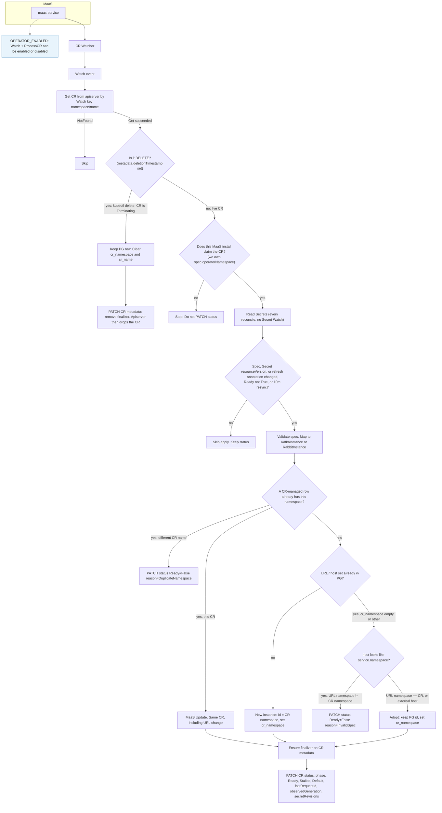

**Key design decisions:**

- The operator runs **cluster-wide** — no static `--watch-namespaces` list. Instance CRs may live in any namespace.
- Each managed CR declares its operator in immutable `spec.operatorNamespace`.
- CRs whose `spec.operatorNamespace` differs from this MaaS `CLOUD_NAMESPACE` are silently skipped (no PATCH, no
  Register).
- Credentials for `KafkaInstance` / `RabbitInstance` are read from Kubernetes Secrets on **every reconcile**. The
  operator does **not** Watch Secrets: a Secret change alone does not enqueue the CR. A rotated Secret is picked up by
  the next reconcile (periodic resync, CR change, or the refresh annotation below). `status.secretRevisions` stores the
  Secret `resourceVersion`s seen at the last apply, never secret bytes; a different revision means MaaS Update.
- **Periodic resync every 10 minutes.** Each claimed instance CR is reconciled again (`MAAS_INSTANCE_RESYNC_INTERVAL`,
  default `10m`) even when spec and Secrets did not change. Re-reads Secrets (this is how rotated credentials arrive),
  refreshes the `Default` condition from PG (install default names), and retries SecretError. An unparsable or
  non-positive value is logged and the default applies. When ProcessCR runs and backoff: [Reconcile](#reconcile).
- **Force a refresh** after rotating a Secret, instead of waiting for the resync: change the
  `maas.netcracker.com/refresh` annotation on the CR. It does not bump `generation`, so the CR informer must not filter
  on generation changes only.

  ```bash
  kubectl annotate kafkainstance <name> maas.netcracker.com/refresh="$(date +%s)" --overwrite
  ```

- Secret access is **namespaced**, not cluster-wide: the ClusterRole carries no `secrets` permission. Each namespace
  containing Secret-backed CRs grants access through a small Role + RoleBinding — see [Secret access
  (namespaced)](#secret-access-namespaced).
- **One Deployment.** ProcessCR runs in `maas-service`, same process as Fiber. No sibling operator pod, no manager REST
  hop, no extra basic-auth/M2M to another MaaS process. Apply is in-process `KafkaInstanceService` /
  `RabbitInstanceService`. See [Single microservice](#single-microservice-reconciler-and-maas-logic-in-one-process).
- **Lease, not a singleton pod.** HPA still scales HTTP. Only the `maas-operator-leader` holder Watches. See
  [Scaling](#scaling-if-it-is-a-single-service).
- **Operator optional.** Helm `OPERATOR_ENABLED` enables or disables Watch + ProcessCR. See [Backward compatibility and
  downgrade](#backward-compatibility-and-downgrade).
- **Delete keeps the PG row.** There is no `deletionPolicy`. `kubectl delete` on the CR always leaves the instance in
  PostgreSQL and hands it back to manager REST (`cr_namespace` and `cr_name` cleared). See
  [Delete](#delete).
- **Finalizer.** `maas.netcracker.com/instance` after successful Register. Without it, `kubectl delete` drops the CR
  before ownership is cleared, and REST stays locked on that row. See [Delete](#delete).
- **Create vs update.** Register vs Update from the unique URL / host set, not from Watch ADDED vs MODIFIED. How a CR
  maps to a PG row: [Name and id in the database](#name-and-id-in-the-database).
- **Status.** `Ready`, `Stalled`, and `Default`. `phase` is for `kubectl`. Automate on conditions.
- **Events.** Optional Kubernetes Events on the instance CR (`K8S_EVENTS_ENABLED`). Same reasons as status. See
  [Kubernetes Events](#kubernetes-events).
- **No SecretRef on the service model.** Mapper loads CR + Secrets into existing `model.KafkaInstance` /
  `RabbitInstance`. InstanceService and the manager REST body stay resolved credentials, not Secret names.
- **cr_namespace.** PG text. Set after the operator Register/adopt. Existing REST rows stay empty until a
  CR writes that id. While the operator is enabled, manager REST may Update only while this is empty; after it is set,
  REST of that id is rejected. See [CR vs REST](#cr-vs-rest).
- **One broker per namespace.** At most one claimed `KafkaInstance` and one claimed `RabbitInstance` per namespace. A
  second CR of that kind in the namespace gets `DuplicateNamespace`. See [Name and id in the
  database](#name-and-id-in-the-database).
- **Default.** MaaS Application `DEFAULT_KAFKA_INSTANCE` / `DEFAULT_RABBIT_INSTANCE` (broker namespace: the CR
  `metadata.namespace`). Empty: first Register is default. Named CR becomes default when it appears. See [Default
  instance](#default-instance).

### Backward compatibility and downgrade

Manager REST stays. Instances can still be Register/Update/Unregister’d when the operator is off. Existing PG rows are
unchanged until a CR adopts them (`cr_namespace` set).

`OPERATOR_ENABLED` turns Watch + ProcessCR on or off. Flipping it false must **not** Unregister instances. Deleting a
CR also must **not** Unregister: the PG row stays.

**Downgrade to a MaaS version without the operator.** Argo CD Sync of an older Application (no Watch, no ProcessCR, no
instance CRDs in that chart).

- PG instance rows stay. Topics/vhosts keep using them. Do not Unregister on rollback.
- Manager REST is the only writer again. The old binary does not read `cr_namespace`; the columns (if the schema
  stays) default empty so the old process still starts. REST Update of those ids works (no lock in that binary).
- Instance CRs are not reconciled. CRDs are installed in zero wave, not by the MaaS chart, so they stay unless the
  zero-wave app drops them. If the CRDs stay, the CRs sit unused. A CR with a finalizer cannot be deleted until the
  finalizer is removed or the CRD is deleted. The PG row stays either way.
- `DEFAULT_KAFKA_INSTANCE` / `DEFAULT_RABBIT_INSTANCE` are ignored (not on the old chart). PG default flags stay.

### Secret access (namespaced)

The ClusterRole is for cluster watch of instance CRs only (`get` / `list` / `watch`, `patch` for the finalizer, status
PATCH). It does **not** include `secrets`. Chart templates: `ClusterRole.yaml`, `ClusterRoleBinding.yaml`, `Role.yaml`
(Lease), `RoleBinding.yaml` under `helm-templates/maas-service/templates/`. All bind the existing `maas-service`
ServiceAccount.

Each namespace that holds a `KafkaInstance` or `RabbitInstance` (and their `*SecretRef` Secrets) needs a Role +
RoleBinding on the operator SA: `get` of Secrets in that namespace (no Secret Watch, so no `list` / `watch`).
Same NS as the CR in v1 (`secretRef.namespace` is out of scope). The broker namespace owner applies it, for example:

```yaml
apiVersion: rbac.authorization.k8s.io/v1
kind: Role
metadata:
  name: maas-operator-secrets
  namespace: kafka-infra            # namespace of the instance CR and its Secrets
rules:
  - apiGroups: [ "" ]
    resources: [ secrets ]
    verbs: [ get ]
---
apiVersion: rbac.authorization.k8s.io/v1
kind: RoleBinding
metadata:
  name: maas-operator-secrets
  namespace: kafka-infra
roleRef:
  apiGroup: rbac.authorization.k8s.io
  kind: Role
  name: maas-operator-secrets
subjects:
  - kind: ServiceAccount
    name: maas-service              # SERVICE_NAME
    namespace: maas                 # MaaS CLOUD_NAMESPACE
```

### Restricted environment

Use when the MaaS Application cannot create cluster-scoped objects. Watch stays cluster-wide. This is **not** “watch
only the MaaS namespace” (rejected — broker CRs live in `kafka-infra` / `rabbit-infra`).

Default (`restrictedEnvironment: false`): the chart creates `ClusterRole` / `ClusterRoleBinding` (instance CRs
cluster-wide: `get` / `list` / `watch`, `patch` for the finalizer, status PATCH; **no `secrets`**; `events` `create` /
`patch` when `K8S_EVENTS_ENABLED`), plus namespaced `Role` / `RoleBinding` for `Lease` `maas-operator-leader` in
`CLOUD_NAMESPACE`, bound to the existing `maas-service` ServiceAccount. CRDs are not in the chart: [CRDs in zero
wave](#crds-in-zero-wave).

`restrictedEnvironment: true`: the chart creates only the namespaced objects. Apply `ClusterRole` and
`ClusterRoleBinding` out of band (cluster-admin) **before** the MaaS Application Syncs. CRDs still come from zero wave.
Per-namespace Secret Roles stay as [Secret access](#secret-access-namespaced). Without the ClusterRole, informers fail.

MaaS Application value:

```yaml
restrictedEnvironment: true    # default false
```

### Reconcile

Leader only. Claimed CRs (`operatorNamespace == CLOUD_NAMESPACE`). Secrets are read on every reconcile. Skip apply if
spec, Secret `resourceVersion`s (vs `status.secretRevisions`) and the refresh annotation are unchanged, `Ready=True`,
and not a resync.

#### When

| Trigger | How |
| --------- | ----- |
| CR create / spec edit / Terminating | Informer Watch `KafkaInstance` / `RabbitInstance` |
| Refresh annotation | `maas.netcracker.com/refresh` changed (CR Watch). Forces apply now, e.g. after a Secret rotation. Does not bump `generation`. |
| Periodic resync | `MAAS_INSTANCE_RESYNC_INTERVAL`, default `10m`. Re-read Secrets (picks up rotation), refresh the `Default` condition, retry SecretError. |
| Secret data change | **Not a trigger.** No Secret Watch. Seen on the next reconcile from a row above. |
| Error return | Transient. Workqueue rate limiter (below). |

**Backoff:**

1. **Error → exponential workqueue.** `SecretError`, `HealthCheckFailed`, apiserver/network. Base `1s`, doubles, cap
   `5m`, 10% jitter. Reset on success. `MAAS_RECONCILE_BACKOFF_BASE` / `MAAS_RECONCILE_BACKOFF_MAX` (defaults `1s` /
   `5m`).
2. **`RequeueAfter`, no error → limiter skipped.** Resync 10m. `Stalled=True` (`InvalidSpec`,
   `DuplicateInstanceName`, `DuplicateNamespace`): `Result{}`, wait for the next CR change (spec or refresh
   annotation).

Health-check is sync Register/Update. No async poll (no 202 / trackingId).

---

## Prerequisites and Installation

### Prerequisites

- Kubernetes 1.32 or newer — the CRDs rely on CEL validation rules (`x-kubernetes-validations`), and the
  operator-assignment cache filter uses CRD **selectable fields** on `spec.operatorNamespace`, which are GA in 1.32. On
  an older server the operator's informers fail to sync at startup.

### Installation

Argo CD installs MaaS (chart in the MaaS Application). Watch + ProcessCR is off unless enabled.

MaaS Application values (first install):

```yaml
OPERATOR_ENABLED: true
DEFAULT_KAFKA_INSTANCE: <broker-namespace>    # optional
DEFAULT_RABBIT_INSTANCE: <broker-namespace>   # optional
K8S_EVENTS_ENABLED: true                     # false: no Events, omit events from ClusterRole
restrictedEnvironment: false                 # true: chart skips ClusterRole; apply it out of band
```

- `OPERATOR_ENABLED: true` — with the default `false` the chart does not start Watch + ProcessCR (no Lease) and
  renders no ClusterRole. Manager REST still runs. CRDs are not in this chart: [CRDs in zero wave](#crds-in-zero-wave).
- `DEFAULT_KAFKA_INSTANCE` / `DEFAULT_RABBIT_INSTANCE` — optional. Broker **namespace** of the instance CR to make the
  MaaS default for that kind (the CR `metadata.namespace`, not its name). Empty or a DNS-1123 label. Empty: first
  registered instance of that kind becomes default. Namespaces unknown yet: omit, then update the MaaS Application and
  Sync. See [Default instance](#default-instance).
- `K8S_EVENTS_ENABLED: true` — [Kubernetes Events](#kubernetes-events). Default on. `false` is a no-op recorder and
  drops `events` from the ClusterRole.
- `restrictedEnvironment: true` — [Restricted environment](#restricted-environment). Cluster-admin applies ClusterRole
  first. CRDs still come from zero wave.

Install **CRDs in zero wave, then MaaS, then Kafka/Rabbit instance CRs**. Brokers may already be running; MaaS does not
proxy traffic. Who becomes the PG default is [Default instance](#default-instance).

How **Kubernetes** and **Argo CD** treat the two install orders. Argo **Sync** is apply to the API. **Health** is
separate: `Ready=False` is Degraded; no status yet is Progressing. A wave that waits for Healthy blocks.

### CRDs then MaaS, then instance CRs

Zero wave installs CRDs from [`crds/`](../crds/). The MaaS chart then deploys `maas-service`. Leader Watches an empty
list. A later wave / other Application applies `KafkaInstance` / `RabbitInstance`.

Kubernetes: kinds exist, apply succeeds, ProcessCR runs on each create. Argo: MaaS Application Healthy (Deployment).
Instance Application Sync green, Health Progressing until ProcessCR PATCHes `Ready`, then Healthy. Topic APIs have no
default until that first Register — same as today. Named default: [Default instance](#default-instance).

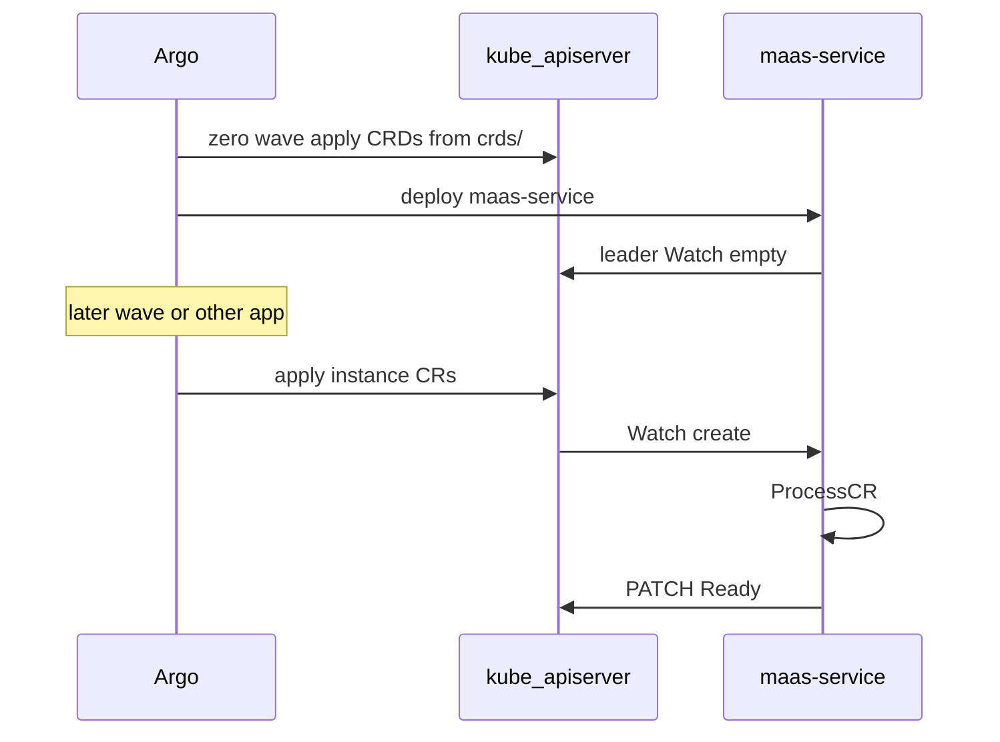

### Instance CRs first (otherwise)

**Bad order.** Kafka/Rabbit (or the instance Application) can already be deployed, then the CR still fails. Brokers do
not need MaaS to run; the GitOps app for the CR does.

**No CRDs (zero wave skipped).** Apiserver rejects the kind. Argo Sync of the instance Application **fails** after the
broker install is already green.

**CRDs exist, operator not watching yet.** Apply writes CRs to etcd. Sync is green. Health stays Progressing, then can
go **Degraded** when ProcessCR later fails (`HealthCheckFailed`, `SecretError`). The instance is already out; the CR is
the thing that looks failed.

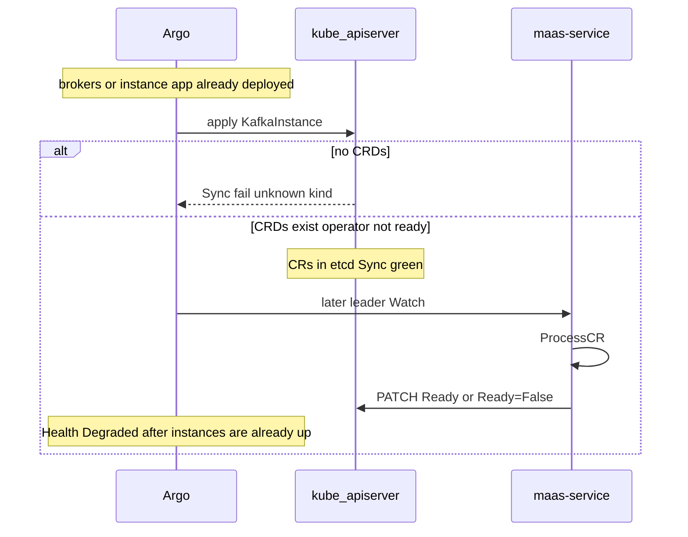

---

## CRD sketch

Two namespaced kinds, group `maas.netcracker.com/v1`: `KafkaInstance`, `RabbitInstance` (any namespace). Claim: required
immutable `spec.operatorNamespace == CLOUD_NAMESPACE`. Credentials live in Secrets in the **same** namespace as the
instance CR (no `secretRef.namespace` in v1). CRD extras: category `maas`, short names, printer columns,
`selectableFields` on `spec.operatorNamespace` (K8s 1.32+), CEL `self == oldSelf` on identity fields.

Field names follow the Kubernetes API conventions, not the REST JSON: acronyms keep one case (`apiURL`, `amqpURL`),
observed state is a condition (`Default`). `status.lastRequestId` keeps its existing spelling (exception).
The CR has one Kafka `address`; protocol and SASL mechanism live on that address, not on the credentials.

| Kind | Short name | `kubectl get` columns |
| ------ | ------------ | ------------------------ |
| `KafkaInstance` | `mkafi` | `PHASE`, `READY`, `DEFAULT`, `AGE` |
| `RabbitInstance` | `mrabi` | `PHASE`, `READY`, `DEFAULT`, `AGE` |

`DEFAULT` is `.status.conditions[?(@.type=='Default')].status`.

### KafkaInstance

#### CR example

What ProcessCR sees after Get on a registered Kafka CR (apiserver-filled metadata included). Inline comments on
spec/status are documentation, not YAML schema.

```yaml
apiVersion: maas.netcracker.com/v1
kind: KafkaInstance
metadata:
  name: kafka-infra                    # Kubernetes object name (examples use the namespace; ProcessCR does not)
  namespace: kafka-infra               # broker NS, or a dedicated NS for an external broker
  uid: 7f3c9a10-4b2e-4d11-9c0a-0b1a2c3d4e5f
  resourceVersion: "184400"
  generation: 3
  finalizers:
    - maas.netcracker.com/instance
spec:
  operatorNamespace: maas-core         # required. Claim: must equal this operator CLOUD_NAMESPACE. CEL immutable (self == oldSelf). RFC-1123
  address:                             # one listener. Admin and client both use it. Mapper writes a one-key PG addresses map
    protocol: SASL_SSL                 # PLAINTEXT | SASL_PLAINTEXT | SSL | SASL_SSL. Replaces REST maasProtocol
    saslMechanism: SCRAM               # PLAIN | SCRAM. Required for SASL_*, forbidden for PLAINTEXT / SSL
    bootstrapServers: ["kafka.kafka-infra:9093"]
    caCertSecretRef:                   # required for SSL / SASL_SSL. Secret.data key is always ca.crt
      name: kafka-ca
  credentials:                         # required. admin and client are both required
    admin:                             # one object. MaaS connects and manages topics with it
      credentialsSecretRef:            # Secret in this namespace. Keys are fixed: username, password
        name: kafka-admin
    client:                            # one object. Returned to applications with topic responses
      credentialsSecretRef:
        name: kafka-client
status:
  phase: BackingOff                    # kubectl column only. Processing | Succeeded | BackingOff | InvalidConfiguration. Automate on conditions, not phase
  lastRequestId: "req-3f8c"            # ProcessCR generates X-Request-Id and PATCHes it (no HTTP header)
  secretRevisions:                     # Secret resourceVersions. Never secret bytes
    kafka-ca: "184291"
    kafka-admin: "184310"
    kafka-client: "184312"
  conditions:                          # Ready + Stalled. list-type=map keyed by type
    - type: Ready                      # True = this generation applied successfully and instance is usable (or Terminating cleanup done)
      status: "False"
      reason: HealthCheckFailed        # see reasons below
      message: "kafka health-check failed: dial tcp kafka.kafka-infra:9092: i/o timeout"
      lastTransitionTime: "2026-08-27T13:40:02Z"
      observedGeneration: 3
    - type: Stalled                    # True = permanent spec error, do not retry until spec changes. False = success or transient retry
      status: "False"
      reason: HealthCheckFailed
      message: "kafka health-check failed: dial tcp kafka.kafka-infra:9092: i/o timeout"
      lastTransitionTime: "2026-08-27T13:40:02Z"
      observedGeneration: 3
    - type: Default                    # observed PG default. Not a request. See Status
      status: "False"
      reason: NotDefault
      message: "MaaS default Kafka instance is kafka-main"
      lastTransitionTime: "2026-08-27T13:30:00Z"
      observedGeneration: 3
  observedGeneration: 3                # stamped on success or Stalled=True. Left behind on transient (BackingOff)
```

#### Resource Fields

| Field | Required | Notes |
| ------- | :--------: | ------- |
| `metadata.name` | Yes | DNS-1123 Kubernetes object name. Not the PG `id` and not the old REST id. Examples use the namespace. |
| `metadata.namespace` | Yes | Broker NS, or a dedicated NS for an external broker. One claimed `KafkaInstance` per namespace. `DEFAULT_KAFKA_INSTANCE` matches this. New rows: PG `id` = this namespace. [Name and id](#name-and-id-in-the-database). |
| `spec.operatorNamespace` | Yes | Claim (`CLOUD_NAMESPACE`). CEL immutable. Skip, no PATCH, if it does not match. |
| `spec.address` | Yes | One listener `{protocol, saslMechanism, bootstrapServers, caCertSecretRef}`. Admin and client share it. Mapper writes a one-key MaaS `addresses` map; REST-registered rows keep whatever map they already have. |
| `spec.address.protocol` | Yes | `PLAINTEXT` \| `SASL_PLAINTEXT` \| `SSL` \| `SASL_SSL`. MaaS connects here (`MaasProtocol`). `SSL` / `SASL_SSL` enable TLS. |
| `spec.address.saslMechanism` | For `SASL_*` | `PLAIN` \| `SCRAM` (SCRAM-SHA-512). Required for `SASL_PLAINTEXT` / `SASL_SSL`, forbidden for `PLAINTEXT` / `SSL` (CEL). |
| `spec.address.bootstrapServers` | Yes | Host:port list. |
| `spec.address.caCertSecretRef` | For TLS | `{name}` same NS. Secret.data key is always `ca.crt`. Required when `protocol` is `SSL` / `SASL_SSL` (CEL). |
| `spec.credentials.admin` | Yes | One credential. MaaS connects to `address` with it. |
| `spec.credentials.client` | Yes | One credential, returned to applications. Only combinations the client libraries support (CEL): see [Client library compatibility](#client-library-compatibility). |
| credential `clientCert` | No | `true`: mTLS. Only with `SSL` / `SASL_SSL` (CEL). Default `false`. |
| credential `credentialsSecretRef` | When there is something to read | `{name}` same NS. Required when `saslMechanism` is set or `clientCert` is true, forbidden otherwise (CEL). Secret.data keys are fixed: `username` + `password` when SASL; also `clientKey` + `clientCert` when `clientCert` is true. |

The MaaS auth `type` is derived, not written:

| `address.protocol` | `saslMechanism` | `clientCert` | MaaS auth type |
| ------- | ------- | ------- | ------- |
| `PLAINTEXT` | — | — | no credential |
| `SASL_PLAINTEXT` | `PLAIN` / `SCRAM` | — | `plain` / `SCRAM` |
| `SSL` | — | `false` / `true` | no credential / `sslCert` |
| `SASL_SSL` | `PLAIN` | `false` / `true` | `plain` / `sslCert+plain` |
| `SASL_SSL` | `SCRAM` | `false` / `true` | `SCRAM` / `sslCert+SCRAM` |

MaaS connects with sarama, which handles every row, so `admin` takes any of them.

#### Client library compatibility

A CR goes through three steps: the operator writes the same instance row manager REST creates (`addresses` as a one-key
map, `maasProtocol`, `caCert`, `credentials` with `admin` and `client`); MaaS connects to Kafka with the `admin`
credential (topic create, update, delete, health check) on that same listener; an application asks MaaS for a topic
and its client library builds the connection from the response. Only the client credential goes into topic responses,
never the admin one. Admin and client share `spec.address`, so the health check uses the same listener as applications.

Topic responses keep the format existing client libraries read. The Go (`qubership-core-lib-go-maas-client`) and Java
(`maas-client`) libraries use only these fields:

```json
{
  "addresses": {
    "SASL_SSL": ["kafka.kafka-infra:9093"]
  },
  "caCert": "MIIDPjCCAiYC...",
  "credential": {
    "client": [
      {"type": "SCRAM", "username": "app-client", "password": "plain:secret"}
    ]
  }
}
```

The address key decides TLS, the credential `type` decides the SASL mechanism and the client certificate, and
`password` must have the `plain:` prefix. The libraries try these address key and credential pairs from the highest
priority down and take the first one the response has:

| Priority | Address key | Credential type | Needs |
| ------- | ------- | ------- | ------- |
| 30 | `SASL_SSL` | `sslCert+SCRAM`, `sslCert+plain`, `SCRAM` | `caCert` |
| 20 | `SSL` | none or `sslCert` | `caCert` |
| 15 | `PLAINTEXT` | `SCRAM` | |
| 10 | `SASL_PLAINTEXT` | `SCRAM` | |
| 0 | `PLAINTEXT` | none or `plain` | |

The libraries have no `SASL_PLAINTEXT` + `plain` pair, so old clients cannot connect to SASL PLAIN without TLS until
they are updated. Topic responses are built from the stored `addresses` map and client credential: a CR writes a
one-key map; a REST-registered row keeps whatever map it already has.

**Client libraries.** Existing client libraries are compatible: a CR-managed response is the same shape they already
read. They should still be adapted to the new Kafka credential design: choose the TLS setting and SASL mechanism from
the listener protocol and the credential (as `address.protocol`, `saslMechanism` and `clientCert` describe it in the
CR), not from a fixed list of address key and credential type pairs. Until then, CEL still rejects row 6. Row 2
(`SASL_PLAINTEXT` + `PLAIN`) is allowed on the CR so a later library fix can use it.

How each `client` credential reaches the libraries. `admin` may use any row:

| # | `address.protocol` | `saslMechanism` | `clientCert` | `caCertSecretRef` | Secret keys | `type` in response | Old library connects with | Old libraries OK |
| --- | --- | --- | --- | --- | --- | --- | --- | --- |
| 1 | `PLAINTEXT` | — | — | — | — | no credential | no auth, no TLS | yes |
| 2 | `SASL_PLAINTEXT` | `PLAIN` | — | — | username, password | `plain` | nothing fits | CR allowed; old libraries cannot connect until updated |
| 3 | `SASL_PLAINTEXT` | `SCRAM` | — | — | username, password | `SCRAM` | SCRAM, no TLS | yes |
| 4 | `SSL` | — | `false` | required | — | no credential | TLS | yes |
| 5 | `SSL` | — | `true` | required | clientKey, clientCert | `sslCert` | TLS + client cert | yes |
| 6 | `SASL_SSL` | `PLAIN` | `false` | required | username, password | `plain` | nothing fits | **no, CEL rejects** |
| 7 | `SASL_SSL` | `PLAIN` | `true` | required | all four | `sslCert+plain` | TLS + cert + PLAIN | yes |
| 8 | `SASL_SSL` | `SCRAM` | `false` | required | username, password | `SCRAM` | TLS + SCRAM | yes |
| 9 | `SASL_SSL` | `SCRAM` | `true` | required | all four | `sslCert+SCRAM` | TLS + cert + SCRAM | yes |

CEL on `client` rejects what no library can use, and names a form that works, except row 2 which is left open:

- `SASL_SSL` + `PLAIN` without `clientCert` (row 6): add `clientCert` (row 7) or use `SCRAM` (row 8).
- `SSL` / `SASL_SSL` without `caCertSecretRef`.
- `SASL_PLAINTEXT` + `PLAIN` (row 2) is accepted; old libraries still cannot connect until they are updated.

CR examples for each row. Only the fields that differ are shown; every CR also has `operatorNamespace` and `admin`.
Secret data keys are fixed by contract (`username`, `password`, `clientKey`, `clientCert`, CA `ca.crt`).

1. No auth, no TLS:

   ```yaml
   address:
     protocol: PLAINTEXT
     bootstrapServers: ["kafka:9092"]
   credentials:
     client: {}
   ```

2. SASL PLAIN, no TLS (CR allowed; old libraries cannot connect until updated):

   ```yaml
   address:
     protocol: SASL_PLAINTEXT
     saslMechanism: PLAIN
     bootstrapServers: ["kafka:9092"]
   credentials:
     client:
       credentialsSecretRef: {name: kafka-client}
   ```

3. SCRAM, no TLS:

   ```yaml
   address:
     protocol: SASL_PLAINTEXT
     saslMechanism: SCRAM
     bootstrapServers: ["kafka:9092"]
   credentials:
     client:
       credentialsSecretRef: {name: kafka-client}
   ```

4. TLS only:

   ```yaml
   address:
     protocol: SSL
     bootstrapServers: ["kafka:9093"]
     caCertSecretRef: {name: kafka-ca}
   credentials:
     client: {}
   ```

5. TLS with a client certificate:

   ```yaml
   address:
     protocol: SSL
     bootstrapServers: ["kafka:9093"]
     caCertSecretRef: {name: kafka-ca}
   credentials:
     client:
       clientCert: true
       credentialsSecretRef: {name: kafka-client-tls}
   ```

6. TLS + SASL PLAIN without a client certificate (rejected):

   ```yaml
   address:
     protocol: SASL_SSL
     saslMechanism: PLAIN        # rejected: use clientCert: true (row 7) or SCRAM (row 8)
     bootstrapServers: ["kafka:9093"]
     caCertSecretRef: {name: kafka-ca}
   credentials:
     client:
       credentialsSecretRef: {name: kafka-client}
   ```

7. TLS + client certificate + SASL PLAIN:

   ```yaml
   address:
     protocol: SASL_SSL
     saslMechanism: PLAIN
     bootstrapServers: ["kafka:9093"]
     caCertSecretRef: {name: kafka-ca}
   credentials:
     client:
       clientCert: true
       credentialsSecretRef: {name: kafka-client}
   ```

8. TLS + SCRAM:

   ```yaml
   address:
     protocol: SASL_SSL
     saslMechanism: SCRAM
     bootstrapServers: ["kafka:9093"]
     caCertSecretRef: {name: kafka-ca}
   credentials:
     client:
       credentialsSecretRef: {name: kafka-client}
   ```

   Topic response:

   ```json
   "addresses": {"SASL_SSL": ["kafka:9093"]},
   "caCert": "MIIDPjCCAiYC...",
   "credential": {"client": [{"type": "SCRAM", "username": "app", "password": "plain:secret"}]}
   ```

9. TLS + client certificate + SCRAM:

   ```yaml
   address:
     protocol: SASL_SSL
     saslMechanism: SCRAM
     bootstrapServers: ["kafka:9093"]
     caCertSecretRef: {name: kafka-ca}
   credentials:
     client:
       clientCert: true
       credentialsSecretRef: {name: kafka-client}
   ```

A CR-managed topic response holds that one listener. Applications pick by the priority above. REST-registered rows may
still store several listeners; the CR cannot.

**Legacy form.** REST-registered rows may have SASL on a `PLAINTEXT` key (`PLAINTEXT` + `plain` or `SCRAM`). They keep
working as before; their topic responses do not change until a CR adopts them. A CR has no such form (`saslMechanism`
is forbidden on `PLAINTEXT`). A row with `PLAINTEXT` + `SCRAM` is adopted as `SASL_PLAINTEXT` + `SCRAM` (row 3). A row
with `PLAINTEXT` + `plain` is adopted as `SASL_PLAINTEXT` + `PLAIN` (row 2); old libraries cannot connect until they
are updated.

**Adopt.** Adopting a REST row writes the CR's one listener and one client credential into PG (the stored map becomes
one key). Choose the pair the libraries pick today (the highest-priority match above). If that pair has no CR form
(row 6), do not create a CR for it; keep managing it through the manager REST API.

Status: [Status](#status).

#### CRD

Generated from the Go CR types with `controller-gen` into [`crds/`](../crds/) (tasks 4.2 and 4.3); not copied here.
Zero wave installs those files before MaaS. The MaaS chart does not ship CRDs.

### RabbitInstance

#### CR example

```yaml
apiVersion: maas.netcracker.com/v1
kind: RabbitInstance
metadata:
  name: rabbit-infra                   # Kubernetes object name (examples use the namespace; ProcessCR does not)
  namespace: rabbit-infra              # broker NS, or a dedicated NS for an external broker
  uid: 1a2b3c4d-5e6f-7081-92a3-b4c5d6e7f809
  resourceVersion: "22010"
  generation: 1
  finalizers:
    - maas.netcracker.com/instance
spec:
  operatorNamespace: maas-core         # required, immutable, same claim as Kafka
  apiURL: http://rabbit.rabbit-infra:15672/api   # Rabbit management API
  amqpURL: amqp://rabbit.rabbit-infra:5672       # AMQP
  credentialsSecretRef:                # Secret in this namespace. Keys are fixed: username, password
    name: rabbit-admin
status:
  phase: Succeeded
  lastRequestId: "req-22010"
  secretRevisions:
    rabbit-admin: "22001"
  conditions:
    - type: Ready
      status: "True"
      reason: InstanceRegistered
      message: "rabbit instance rabbit-infra registered"
      lastTransitionTime: "2026-08-27T13:41:02Z"
      observedGeneration: 1
    - type: Stalled
      status: "False"
      reason: Succeeded
      message: "applied"
      lastTransitionTime: "2026-08-27T13:41:02Z"
      observedGeneration: 1
    - type: Default
      status: "True"
      reason: Configured
      message: "namespace matches maas default property"
      lastTransitionTime: "2026-08-27T13:41:02Z"
      observedGeneration: 1
  observedGeneration: 1
```

#### Resource Fields

| Field | Required | Notes |
| ------- | :--------: | ------- |
| `metadata.name` | Yes | Same as Kafka: Kubernetes object name only. |
| `metadata.namespace` | Yes | Broker NS, or a dedicated NS for an external broker. One claimed `RabbitInstance` per namespace. `DEFAULT_RABBIT_INSTANCE` matches this. |
| `spec.operatorNamespace` | Yes | Same claim as Kafka. CEL immutable. |
| `spec.apiURL` | Yes | Rabbit management HTTP API, `http://` or `https://`. MaaS appends `/api` if missing. Unique. |
| `spec.amqpURL` | Yes | AMQP URL returned to applications, `amqp://` or `amqps://`. Unique. |
| `spec.credentialsSecretRef` | Yes | `{name}` same NS. Secret.data keys are fixed: `username`, `password`. Mapper copies `username` into the REST `User` field. |

Status: [Status](#status).

#### CRD

Generated from the Go CR types with `controller-gen` into [`crds/`](../crds/) (tasks 4.2 and 4.3); not copied here.
Zero wave installs those files before MaaS. The MaaS chart does not ship CRDs.

### Secrets

Secrets referenced by the CR examples above. They hold only values. Secret.data keys are fixed by contract; the CR
names the Secret, not the keys. The Kafka protocol and mechanism are on `spec.address`. Passwords are stored raw.

```yaml
apiVersion: v1
kind: Secret
metadata:
  name: kafka-ca
  namespace: kafka-infra
type: Opaque
stringData:
  ca.crt: |
    -----BEGIN CERTIFICATE-----
    ...
    -----END CERTIFICATE-----
---
apiVersion: v1
kind: Secret
metadata:
  name: kafka-admin
  namespace: kafka-infra
type: Opaque
stringData:                       # credentials.admin (SASL_SSL, SCRAM)
  username: admin
  password: "..."
---
apiVersion: v1
kind: Secret
metadata:
  name: kafka-client
  namespace: kafka-infra
type: Opaque
stringData:                       # credentials.client. With clientCert: also clientKey and clientCert
  username: app-client
  password: "..."
---
apiVersion: v1
kind: Secret
metadata:
  name: rabbit-admin
  namespace: rabbit-infra
type: Opaque
stringData:
  username: guest
  password: "..."
```

### Status

Shared by `KafkaInstance` and `RabbitInstance`. ProcessCR PATCHes it. Do not put these on spec.

| Field | Notes |
| ------- | ------- |
| `status.phase` | `Processing` \| `Succeeded` \| `BackingOff` \| `InvalidConfiguration`. kubectl only. |
| `status.conditions` | `Ready`, `Stalled`, `Default` (`metav1.Condition`, list-type map keyed by `type`). |
| `status.lastRequestId` | ProcessCR `X-Request-Id` (no HTTP header). |
| `status.observedGeneration` | Stamped on success or `Stalled=True`. Left behind on transient. |
| `status.secretRevisions` | Secret `resourceVersion`s seen at the last apply. Compared on each reconcile to detect rotation. Never secret bytes. |

| Ready / Stalled | Meaning |
| ----------------- | --------- |
| `Ready=True`, `Stalled=False` | Applied. Retry not needed. |
| `Ready=False`, `Stalled=False` | Transient. Retry. |
| `Ready=False`, `Stalled=True` | Permanent. Wait for spec change. |

| Reason | Ready | Stalled | Meaning |
| -------- | ------- | --------- | --------- |
| `InstanceRegistered` | True | False | Register/Update succeeded. |
| `SecretError` | False | False | Secret missing, key missing/empty, or forbidden. |
| `HealthCheckFailed` | False | False | Register/Update health-check 400. Do not Unregister a previous good row. |
| `InvalidSpec` | False | True | Kafka address or Rabbit URL used by another id, or a spec the CRD let through but MaaS rejects. |
| `DuplicateInstanceName` | False | True | Another CR owns that id. |
| `DuplicateNamespace` | False | True | Another CR of this kind already owns this namespace. Message names that CR. |

`Default` is observed PG state, separate from `Ready`: an instance can be ready and not default, or default while its
last update failed. ProcessCR sets it after Register/Update and on resync ([Default instance](#default-instance)):

| `Default` | Reason | Meaning |
| --------- | -------- | --------- |
| True | `Configured` | PG default, and the CR namespace matches the MaaS default property. |
| True | `ForcedDefault` | PG default, not named by the param: first instance of its kind, or set earlier (REST SetDefault, an old param). |
| False | `NotDefault` | Another instance is the PG default. Message names it. |

No `Default` condition before the first successful Register (no PG row yet).

Finalizer `maas.netcracker.com/instance` after Register. `deletionTimestamp` set means Terminating. A Secret rotation
or the refresh annotation does not bump `generation`.

---

## Kubernetes Events

ProcessCR may emit a Kubernetes Event on the instance CR (`involvedObject` = that CR). The Event lives in the **CR
namespace** (`kafka-infra` / `rabbit-infra`), not in `CLOUD_NAMESPACE`. Same `reason` strings as [Status](#status).

`K8S_EVENTS_ENABLED` (default `true`). `false`: recorder is a no-op; chart omits `events` `create` / `patch` from the
ClusterRole (and from the out-of-band ClusterRole when `restrictedEnvironment: true`).

**Emit** when ProcessCR first writes that reason (or the reason changes). **Do not emit** on skip-apply, skip-claim, or
10m resync that stays `Ready=True`. The `Default` condition (`Configured`, `ForcedDefault`, `NotDefault`) stays
status-only.

| Reason | Type | When |
| -------- | ------ | ------ |
| `InstanceRegistered` | Normal | Register/Update succeeded. |
| `InvalidSpec` | Warning | Kafka address or Rabbit URL used by another id, etc. |
| `SecretError` | Warning | Secret missing, key missing/empty, or forbidden. |
| `HealthCheckFailed` | Warning | Register/Update health-check 400. |
| `DuplicateInstanceName` | Warning | Another CR owns that id. |
| `DuplicateNamespace` | Warning | Another CR of this kind already owns this namespace. |

ClusterRole (not the namespaced Secret Role) grants `events` `create` / `patch` so Events can land in the broker
namespace. `kubectl describe kafkainstance … -n kafka-infra` shows them.

---

## Mapping layer (CR vs service structs)

`*SecretRef` and `operatorNamespace` do **not** belong on
`[model.KafkaInstance](../maas/maas-service/model/kafka_model.go)` /
`[RabbitInstance](../maas/maas-service/model/rabbit_model.go)`. Those structs are the REST body and the PostgreSQL row:
they store **resolved** `caCert`, `credentials` / `user`+`password`, not pointers to Secrets. Putting refs there would
change the public manager API and persist names instead of secrets.

Add a **new operator layer** (not a new DB table):

- CR Go types (`KafkaInstance` / `RabbitInstance`, `KafkaAddress`, `KafkaCredential`, `SecretNameRef`) live in the
  operator package. They are the apiserver schema. Kind names match the service models (`model.KafkaInstance` /
  `model.RabbitInstance`); the packages differ so the types do not collide.
- Mapper: load CR + Secrets → fill existing `model.KafkaInstance` / `RabbitInstance` (`Id` from [Name and
  id](#name-and-id-in-the-database), `Addresses` (one-key map from `spec.address`), `Default: false`, `MaasProtocol`,
  `CACert`, `Credentials` / `ApiUrl`, `AmqpUrl`, `User`, `Password`). Instance mapper never sets `Default: true`.
- Kafka: `MaasProtocol` = `address.protocol`. `Credentials["admin"]` and `Credentials["client"]` are lists with the one
  entry each, its auth type derived from `address.protocol` + `saslMechanism` + `clientCert` ([Resource
  Fields](#resource-fields)). Neither needs a Secret (for example `PLAINTEXT` and `SSL` without `clientCert`) →
  `Credentials` nil. MaaS accepts both roles or neither, so CEL requires `admin` and `client` to both need a Secret or
  both not. Secret.data keys are fixed (`username`, `password`, `clientKey`, `clientCert`, CA `ca.crt`). Secrets hold
  the raw password; the mapper sends `plain:<password>`, the only password format MaaS accepts. Rabbit Secret
  `username` is copied into the REST `User` field.
- Apply still calls `KafkaInstanceService` / `RabbitInstanceService` with that model. No SecretRef in the service.
  `SetDefault` is driven by `DEFAULT_KAFKA_INSTANCE` / `DEFAULT_RABBIT_INSTANCE` after Register/Update ([Default
  instance](#default-instance)).

Optional DB columns on the instance row (`cr_namespace`, `cr_name`) are schema extras, not a second instance
struct. `cr_namespace` is the owning CR namespace. Existing rows:
`cr_namespace` empty until a CR writes them. `cr_name` is not used for matching.

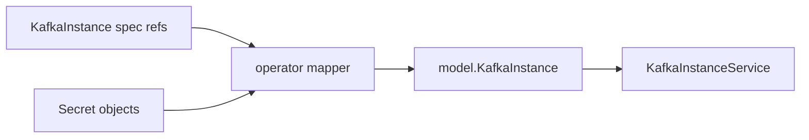

---

## Topology

### Single microservice (reconciler and MaaS logic in one process)

One Deployment, one process. The **leader** replica runs the watch loop in-process (see
[Scaling](#scaling-if-it-is-a-single-service)). Followers run only the existing MaaS logic (Fiber). Sibling Deployment
comparison: [operator_design_notes.md](operator_design_notes.md#scenario-a-vs-b-recommendation).

**Apply path: Go services, not HTTP.** ProcessCR is wired to the same
`[KafkaInstanceService](../maas/maas-service/service/instance/kafka_instances_service.go)` /
`[RabbitInstanceService](../maas/maas-service/service/instance/rabbit_instances_service.go)` as
`[InstanceController](../maas/maas-service/controller/instance_controller.go)`. Do not POST localhost `/api/v2/...`.

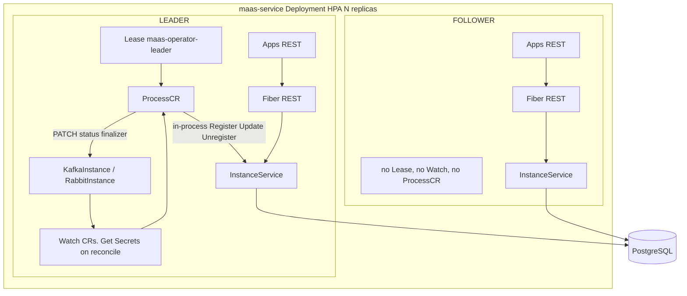

ProcessCR lives **inside** the `maas-service` binary, next to Fiber. Only the Lease holder starts Watch + ProcessCR.
Followers serve Fiber REST only — they do **not** forward Register to the leader. Apps hit any replica; CR apply is
leader-only, in-process.

#### Features

- One Deployment, one process. HPA stays; do not pin `REPLICAS: 1`. The operator is a singleton *role* (Lease), not a
  singleton *pod*.
- Apply is in-process `InstanceService`. No localhost HTTP.
- `status.lastRequestId`: ProcessCR generates `X-Request-Id`, puts it on the Go context (InstanceService logs), PATCHes
  the CR. Fiber `ExtractOrAttachXRequestId` is not on this path.
- ClusterRole (cluster watch) lands on the HTTP SA.
- Watcher panic / client-go deadlock can take REST down.
- Already has `drMode`.
- Helm flag on the existing chart (`OPERATOR_ENABLED`).
- Start controller-runtime alongside Fiber in `[server.go](../maas/maas-service/server.go)`.

---

### Scaling if it is a single service

If the reconciler is embedded in `maas-service` (one Deployment, one process), **keep today’s HTTP scaling**. The
operator is a singleton *role*, not a singleton *pod*. Do not pin `REPLICAS: 1` or disable HPA.

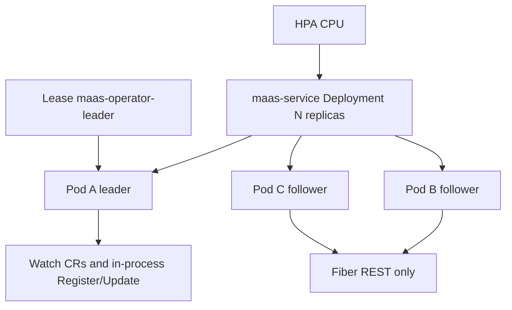

Replicas do **not** talk to each other about who watches. Kubernetes is the source of truth: a namespaced `Lease`
`maas-operator-leader`. At most one replica holds it; that replica is the watcher. Everyone else is HTTP-only until the
lease changes. Mechanism (acquire, renew, expire, 409 on the Lease object, code samples): [Kubernetes Lease
lock](operator_design_notes.md#kubernetes-lease-lock).

#### What `maas-operator-leader` is

- **Lease** `maas-operator-leader` — `coordination.k8s.io/v1` in `CLOUD_NAMESPACE`. This **is** the lock.
  `holderIdentity` = pod name.
- **Metric** `maas_operator_leader` — optional gauge (`1` = this process holds the Lease). Not a lock; other replicas
  must not use it to decide who watches.

```yaml
apiVersion: coordination.k8s.io/v1
kind: Lease
metadata:
  name: maas-operator-leader
  namespace: maas-core
spec:
  holderIdentity: maas-service-7f8c9d-xk2l
  leaseDurationSeconds: 15
```

`kubectl get lease maas-operator-leader -n maas-core` shows the watcher.

How replicas campaign, callbacks, followers, DR, two MaaS, RBAC:
[operator_design_notes.md](operator_design_notes.md#how-replicas-know-who-is-watching).

- Leave `[REPLICAS](../helm-templates/maas-service/values.yaml)` and HPA as they are.
- Start `controller-runtime` in a goroutine from `[server.go](../maas/maas-service/server.go)` with **LeaderElection =
  true**. Inject the already-constructed `kafkaInstanceService` / `rabbitInstanceService` (same objects as the REST
  controllers).
- Size informer cache modestly (two CRDs; Secrets are read with Get, not cached). Do not raise HTTP CPU targets just
  for the operator.
- Keep Register/Update/Unregister idempotent (in-process Unregister of missing id = success).

Several replicas watching the same CRs is a bug (two writers on one PG registry). Cases: [Why several MaaS replicas
watching the same CRs is a bug](operator_design_notes.md#why-several-maas-replicas-watching-the-same-crs-is-a-bug).

---

## Special cases

Defaults, name/id in PG, REST coexistence, delete/lifecycle, and multi-MaaS. ProcessCR rules above still apply.

### Default instance

MaaS allows **one** default Kafka instance and **one** default Rabbit instance per PostgreSQL. Topics/vhosts with no
`instance` id use that default.

No `spec.default` on the instance CR and no `DefaultInstance` CR. Names come from the MaaS Argo CD Application:
`DEFAULT_KAFKA_INSTANCE` / `DEFAULT_RABBIT_INSTANCE`. Install: [Prerequisites and
Installation](#prerequisites-and-installation).

First insert into an empty DB still becomes default (`ForcedDefault` in
[DAO](../maas/maas-service/service/instance/kafka_instances_dao.go)) when the install param for that kind is empty, or
when the named CR is not registered yet. “First” is whichever Register commits.

**Install params.** Optional. Value = broker **namespace**: the `metadata.namespace` of the claimed instance CR of that
kind. Kafka and Rabbit are independent. The namespace is known before the CR registers, it always names a CR (never a
REST-only row), and it is unique because a namespace holds at most one claimed CR of each kind ([Name and
id](#name-and-id-in-the-database)). For a new instance it also equals the PG id. If the namespaces are not known yet,
install MaaS without them and update the MaaS Application afterwards (Argo CD Sync).

The param is the CR namespace (`name` equals that namespace). Matching on a free-form CR name is not used.

ProcessCR on a claimed instance CR (Watch, Argo CD Sync of MaaS after a param change, or 10m resync), Kafka and Rabbit
separately:

1. **Param empty** for this kind. No default in PG → this Register is `ForcedDefault`. Default already in PG → leave it.
   PATCH the `Default` condition from PG. Do not steal on every reconcile.
2. **Param set**, this CR `metadata.namespace` equals the param, row exists, not already default → `SetDefault` this
   id. Already default → PATCH status only (do not `SetDefault` again on every Watch / 10m resync).
3. **Param set**, this CR namespace does not match. No default in PG → `ForcedDefault` this instance (topics work until
   the named CR appears). Default already in PG → leave it.
4. **Param set**, no claimed CR of that kind in the named namespace yet (none applied, not claimed by this MaaS, or
   stalled). MaaS stays Healthy. Do not fail Argo. Do not clear PG. When that CR Registers (or on the next reconcile
   after a later MaaS Application Sync), rule 2 runs.
5. **Namespaces unknown at first MaaS install.** Omit the params. First Register is `ForcedDefault`. Later update the
   MaaS Application with the namespaces and Sync; the Deployment rolls, ProcessCR sees the new env, rule 2 `SetDefault`s
   the named CR (may switch the ForcedDefault winner).
6. Clearing a param later does **not** unset the PG default. Do not send Update `default: false` on the current default
   (DAO 400).
7. **Manager REST SetDefault.** While `OPERATOR_ENABLED` is true and the param for that kind is set, REST SetDefault
   returns 409 naming the param: the operator would move the default back on the next reconcile. With the param empty,
   REST SetDefault works, for CR-managed rows too.

The `Default` condition is observed PG state, not a request. PATCH it on the CRs this reconcile touches (and on the previous
default after a switch).

Manager REST steal is unchanged. This naming rule is operator-only.

**Deploy order.** If MaaS does not exist, CRs cannot exist ([Prerequisites and
Installation](#prerequisites-and-installation)). The `ForcedDefault` “first informer item” case is only after CRDs exist
and the leader Lists several CRs at once. First Register into empty PG wins. If the install param names another CR
already in that List, rule 2 then `SetDefault`s it.

If the operator is already watching and CRs are applied one by one, the first Register is ForcedDefault unless that CR
already matches the param.

A REST instance that is already default is not moved until the install param names a registered CR.

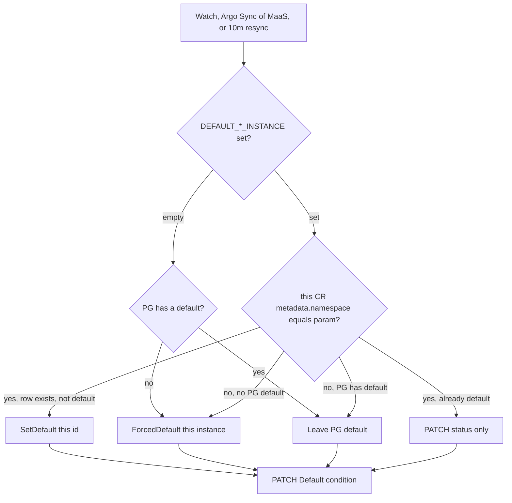

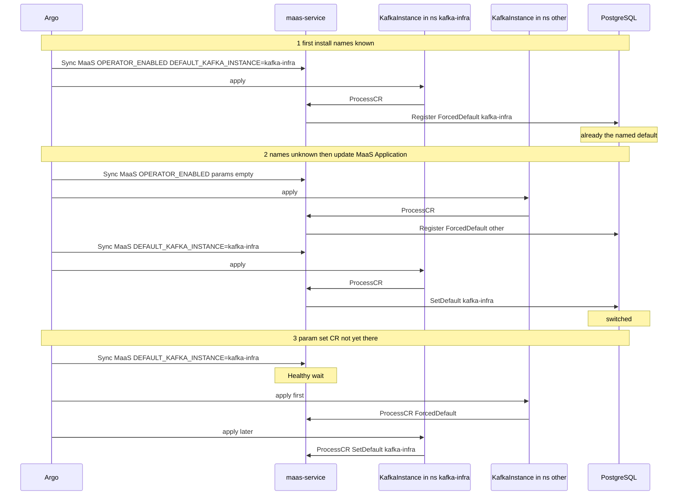

---

### Name and id in the database

`metadata.namespace` is the CR identity (new PG `id`, `cr_namespace`, `DEFAULT_*_INSTANCE`). `metadata.name` is only the
Kubernetes object name; generated examples set it equal to the namespace. The CR lives in the broker namespace, or in a
dedicated namespace for an external broker — not in the MaaS namespace as the way to name the broker. The old REST `id`
is never put on the CR (GitOps does not know it). Topics, vhosts, and instance designators FK the PG `id`; ProcessCR
never renames it.

The join to a PG row is the **unique URL / host set**, not `GetById(name)` or `GetById(namespace)`.

- Kafka: hosts from `spec.address.bootstrapServers`, treated as a **set** (strip port, sort, ignore order). In-cluster
  form is `service.namespace` (or `service.namespace.svc.cluster.local`); the namespace is part of the URL.
- Rabbit: AMQP host from `spec.amqpURL` (same `service.namespace` assumption). `apiURL` stays unique as today.

**One broker per namespace.** At most one claimed `KafkaInstance` and one claimed `RabbitInstance` per namespace.
External brokers each get their own dedicated namespace so that rule still holds. Migration 31: partial unique index
`(cr_namespace) WHERE cr_namespace <> ''`. Owner matching uses `cr_namespace` only (`cr_name` is not a lookup key).
`DEFAULT_*_INSTANCE` is that namespace.

`MAAS_KAFKA_INSTANCE_BODY` / `MAAS_RABBIT_INSTANCE_BODY` stay as the legacy install path: they Register PG rows (`id` +
URLs) before any CR. They are not a namespace allowlist. Adopt still uses the URL set those bodies stored.

#### Register vs adopt

Ownership (`cr_namespace`) is checked **before** the URL / host set. Empty `cr_namespace` (unmanaged REST / body row)
does **not** match; fall through to the URL check. A CR that already owns the namespace Updates its row even when the
spec URLs changed (recovery, new listener). Join-by-URL is only for first bind (Register / adopt).

```text
A row already has cr_namespace == this CR namespace
  → cr_name is this CR
        → UPDATE that row (keep id), even if the URL / host set changed
  → cr_name is another CR
        → DuplicateNamespace, no write

Else URL set not in PG
  → INSERT  id = CR namespace, cr_namespace = CR namespace

Else URL set already in PG
  → host looks like k8s (namespace in URL) AND that namespace != CR namespace
        → reject (Ready=False, Stalled=True, InvalidSpec)
  → else  (URL namespace == CR namespace, or host is not k8s / external)
        → ADOPT: keep PG id, set cr_namespace = CR namespace
```

Treat a host as k8s when the namespace is unambiguous: exactly two labels (`kafka.kafka-infra`) or `*.svc` /
`*.svc.cluster.local`. Otherwise external (IP, `broker.example.com`): skip the URL-namespace check and adopt.

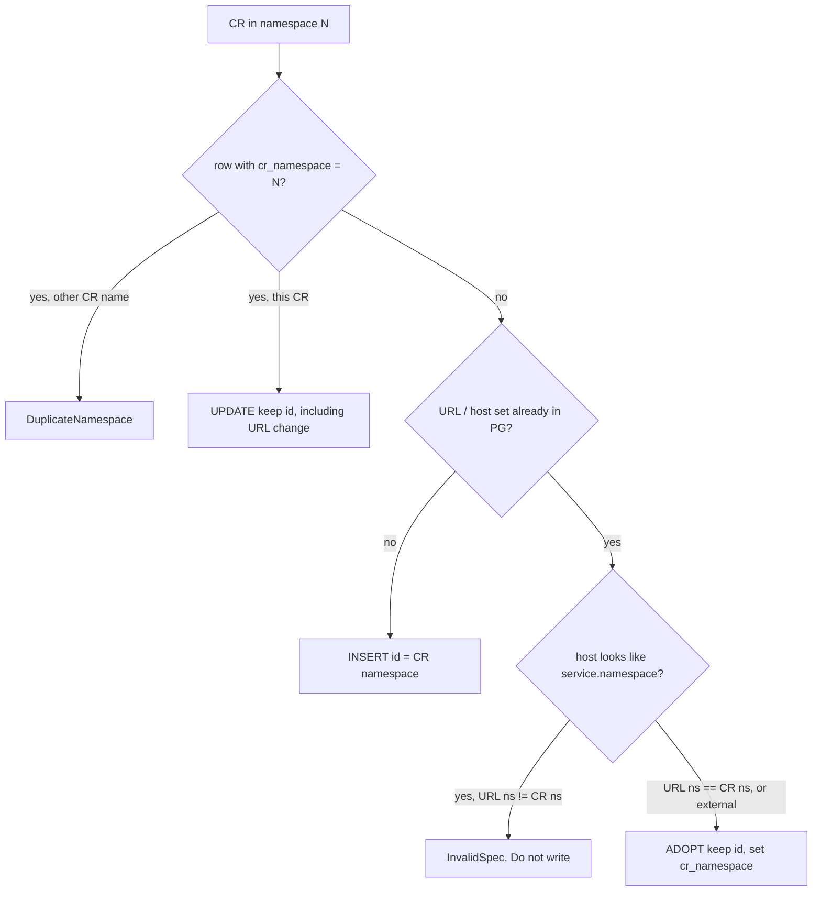

Copy-paste of an in-cluster CR into another namespace is rejected (URL names `kafka-infra`, CR is `team-foo`). External
hosts have no namespace in the URL, so a second dedicated namespace with the same URL can adopt; tighten later if
needed.

Instance designators keep storing the **PG `id`**. After adopt that is still the old REST / body id, not the CR
namespace. New rows use the CR namespace as `id`, so new designators use that.

**Rabbit URL uniqueness.** A DB migration adds a unique index on `rabbit_instances.api_url` and one on
`rabbit_instances.amqp_url`, matching the Kafka `addresses` constraint. It applies to manager REST and to CRs alike.

**Existing duplicates fail the upgrade.** Before creating the indexes, the migration looks for rows that already share
`api_url` or `amqp_url`. If it finds any, it creates nothing, and `maas-service` exits at startup with one error that
lists every shared URL and the instance ids using it:

```text
rabbit_instances: URLs shared by several instances, upgrade stopped:
  api_url  http://rabbit.rabbit-infra:15672/api used by instances [rabbit-old, rabbit-infra]
  amqp_url amqp://rabbit.rabbit-infra:5672      used by instances [rabbit-old, rabbit-infra]
Leave one instance per URL, then restart maas-service.
```

The new pods do not become ready, so a rolling update keeps the previous version serving. To fix, keep one id per
broker: move the other id's vhosts and instance designators to it and Unregister the empty id, or correct the URL of a
row registered with the wrong one. Then restart; the migration runs again.

---

### CR vs REST

Manager REST already inserts rows into PostgreSQL. The CR finds that row by URL / host set: [Name and id in the
database](#name-and-id-in-the-database). The first matching CR **Updates** the row (adopt): copy spec+Secrets, set
`cr_namespace`. Topics/vhosts stay. Applying the CR **is** the migrate.

**One owner.** `cr_namespace` (existing rows empty):

- empty — REST row, never written by a CR. Manager REST may still Update that id.
- set — a CR already Register’d or adopted it. REST Update/Unregister of that id is **rejected**. Later CR reconciles
  are normal Updates.
- Two CRs whose URL set names another namespace: `InvalidSpec`. Default switch is [Default
  instance](#default-instance), not a flag on those CRs.

**Migrate back to REST.** Two ways, never two writers on a live CR:

- Delete the CR. ProcessCR clears `cr_namespace` and `cr_name` on the row before
  removing the finalizer. The row stays; manager REST may Update/Unregister it again.
- `OPERATOR_ENABLED=false`. The REST lock is enforced only while the operator is enabled, so REST works on every row.
  Rows keep `cr_namespace` set; turning the operator back on locks them again.

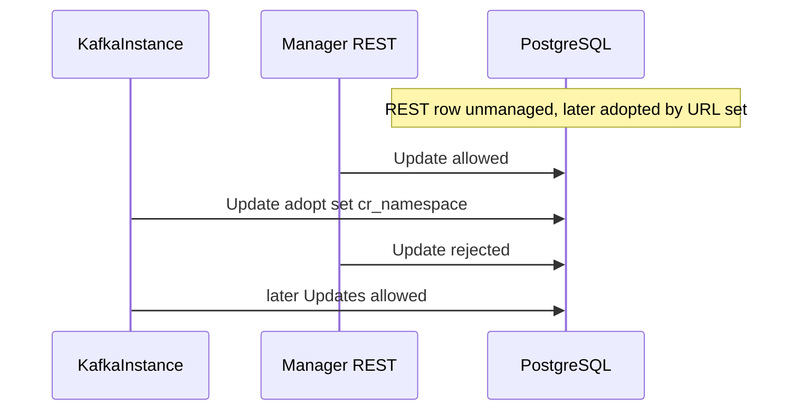

---

### CR lifecycle (watcher, create vs update vs delete, delete with existing topics or vhosts)

Kubernetes Watch is level-triggered: every event is “reconcile this key”, not a typed create/update. **ProcessCR must
choose Register vs Update** by the unique URL / host set, not by ADDED vs MODIFIED.

#### Watcher, create vs update vs delete

The picture below is **four different times**, not one call that Registers then Updates twice.

##### Four times: Register, Secret Update, spec Update, Delete

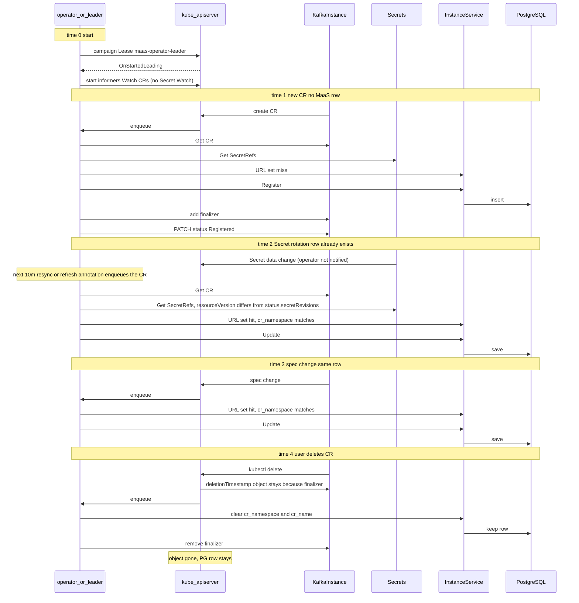

Watcher init happens once per leader (`OnStartedLeading`). Followers do not Watch. DR standby may hold the Lease but
must not Register/Update/Unregister.

##### Create vs update

- A row already has this `cr_namespace` and a **different** CR name → `DuplicateNamespace`, no write.
- A row already has this `cr_namespace` and **this** CR name → **Update** that id (URL change, Secret rotation, spec
  edits). Do not join by URL first.
- Else find the row by URL / host set ([Name and id](#name-and-id-in-the-database)).
- **Register** only if no row has that URL set (`id` = CR namespace).
- **Adopt** if a row hits, `cr_namespace` is empty or other, and the URL namespace matches (or the host is external).
- **Reject** (`InvalidSpec`) if a row hits and the in-cluster URL namespace is not this CR.

**Finalizer is set while the CR is live; it only *acts* on delete.**

`metadata.finalizers` is a list of strings. Adding `maas.netcracker.com/instance` does **not** delete anything. It tells
the apiserver: when the user later runs `kubectl delete`, **do not remove the object from etcd** until this controller
PATCHes that string **off** the list.

We add it **after a successful Register** (not in the delete handler):

- If we added it only when `deletionTimestamp` is set, current apiservers **reject adding** a finalizer during deletion.
  The CR would vanish and the MaaS row could stay.
- After Register we must survive crash/restart: the CR still exists, the finalizer is already there, delete will wait
  for ownership to be cleared.

On delete: see `deletionTimestamp` → clear `cr_namespace` / `cr_name` → **remove** the
finalizer. That is the only moment the finalizer “does work”. `PATCH status Registered` is a separate write to
`status.conditions`; it is not the finalizer.

#### Delete

There is no `deletionPolicy`. Deleting the CR always keeps the PG row and hands it back to manager REST.

##### How delete works (and why deletionTimestamp exists)

User asks Kubernetes to delete the CR → apiserver does **not** drop the object if a finalizer is set → it only writes
`metadata.deletionTimestamp` → we clear operator ownership on the PG row → we remove the finalizer → apiserver then
deletes the CR from etcd. Topics and vhosts keep using the instance.

`deletionTimestamp` is **the delete request**, recorded on the object that is still there. We need it because, with a
finalizer, `Get` still succeeds. Without that timestamp, ProcessCR cannot tell “user wants this gone” from “normal
Update”.

Without a finalizer there is no timestamp: `kubectl delete` removes the object immediately, next reconcile is
`NotFound`, and the row keeps `cr_namespace` set, so REST stays locked. The finalizer keeps the CR in
`Terminating` until ownership is cleared.

##### kubectl delete

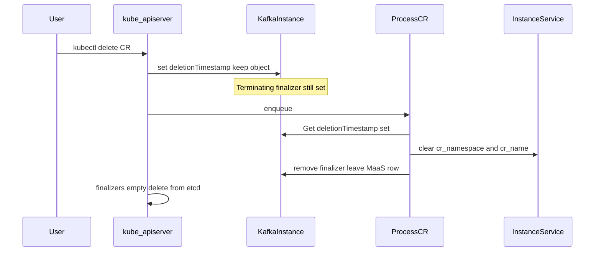

There is no “undelete CR.” The MaaS row stays; manager REST may Update or Unregister it again.

#### Delete with existing topics or vhosts

CR delete does **not** Unregister, so topics and vhosts are not a blocker. Manager REST Unregister still deletes the
PostgreSQL row and still returns 400 if topics or vhosts reference that instance (the same FK as today). That 400 is a
REST error, not a CR status reason.

---

### Multi-MaaS and ownership

Each MaaS has its own PostgreSQL. A Lease does **not** separate two installs (each namespace has its own
`maas-operator-leader`).

Claim is **`spec.operatorNamespace`**. Required, CEL-immutable. ProcessCR applies only if it equals this MaaS
`CLOUD_NAMESPACE`. Omitted or other namespace: skip, **do not PATCH**. Watch is the whole cluster (instance CRs);
`operatorNamespace` is who applies.

Rejected alternatives (watch-only-own-NS, watch-list, namespace annotation) and the dual-Register bug: [Multi-MaaS
alternatives](operator_design_notes.md#multi-maas-alternatives).

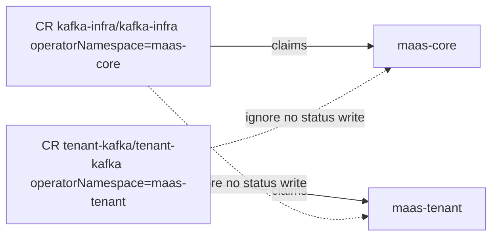

#### CRDs in zero wave

CRDs are cluster-scoped and are **not** in the MaaS chart. `controller-gen` writes them to [`crds/`](../crds/) (raw
YAML, no Helm). Platform zero wave installs that folder **before** MaaS, so kinds exist when `maas-service` starts.
Several MaaS installs in one cluster share those CRDs; they do not fight over Helm ownership.

`restrictedEnvironment` still skips the chart ClusterRole. Apply ClusterRole out of band for a second operator-enabled
MaaS if needed.

DR standby does not reconcile. Replica HA for **one** MaaS is the Lease ([Scaling](#scaling-if-it-is-a-single-service)),
not `operatorNamespace`. Composite / tenant app namespaces are unrelated: the operator still sees those CRs (cluster
watch); it claims only when `operatorNamespace` matches.

---

## Related notes

OpenSpec change (proposal, design, delta specs, tasks):
`[openspec/changes/maas-broker-instance-operator](../openspec/changes/maas-broker-instance-operator)`. This document
stays the architecture write-up (diagrams, CRD sketch). Implement from the OpenSpec tasks after the SPEC PR merges.

See `[operator_design_notes.md](operator_design_notes.md)`: [Scenario A vs B
recommendation](operator_design_notes.md#scenario-a-vs-b-recommendation), [Kubernetes Lease
lock](operator_design_notes.md#kubernetes-lease-lock), [How replicas know who is
watching](operator_design_notes.md#how-replicas-know-who-is-watching), [Why several MaaS replicas watching the same CRs
is a bug](operator_design_notes.md#why-several-maas-replicas-watching-the-same-crs-is-a-bug), [Multi-MaaS
alternatives](operator_design_notes.md#multi-maas-alternatives).
